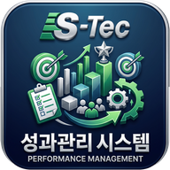

# S-Tec Performance Management System (에스텍 성과 관리 시스템)



**에스텍 그룹 성과 관리 시스템** · v1.0.1 · 통합관리 시스템 10번째 프로그램 (`stpm`)

> 용역 업무의 가장 좋은 결과는 「아무 일도 일어나지 않는 것」입니다. 그래서 고객사는 「하는 게 없다」고 느끼기 쉽습니다.
> 이 프로그램은 그 **「일어나지 않은 일」을 기록하고 세어** 일일·주간·월간·연간 성과와 환산가치로 보여 줍니다.

## 내려받기

| 구분 | 주소 |
|---|---|
| 웹 버전 | https://sadness500-boop.github.io/S-Tec-Performance-Management-System/ |
| 파일 하나로 여는 배포본 | `releases/S-Tec-Performance-Management-System_v1.0.1.html` |
| 안드로이드 앱 (최신) | https://github.com/sadness500-boop/S-Tec-Performance-Management-System/releases/download/app-latest/stpm-latest.apk |

- **APK는 GitHub Actions가 만듭니다.** `index.html`·`version.json`을 올리면 Actions 「Android APK」가 약 5분 뒤 `releases/`와 릴리스에 APK를 올립니다.
- **웹 주소를 열려면** 저장소 Settings › Pages › Branch를 `main` / `/(root)`로 한 번 켜야 합니다.

## 성과 계수화 — 4원칙 + SPI

| 원칙 | 내용 |
|---|---|
| ① 업무량 | 순찰 · 청소 면적 · 설비 점검 · 출입관리 등 매일 하는 일을 건·회·명·㎡ 단위로 기록 |
| ② 예방·적발 | 소등 · 시건 · 누수 · 무단침입 · 반출입 오차 등 「사고를 막은」 활동 |
| ③ 환산가치 | 절전액(르노삼성 부산공장 산출기준) · 외주 대체비 · 적발 금액을 원(₩)으로 — 기준표는 고객사 협의값으로 조정 |
| ④ 달성률·품질 | 계획 대비 실적 · 자체 품질평가 · 운영실태·품질점검 점수 |

**SPI(S-Tec Performance Index)** = 계획 달성 35% + 품질 25% + 안전(사건 전건 조치) 20% + 업무개선 10% + 교육 10% · 90↑ S 우수 · 80↑ A 양호 · 70↑ B 보통 · 70 미만 C 미흡

## 업종 × 산업

- 업종 5종: 보안·경비(31항목) · 미화·환경(22) · 시설관리(17) · 주차관리(11) · 안내·리셉션(9) — 산업에 맞는 항목만 표시(예: 계근·세륜은 공장·물류, 의료폐기물은 병원)
- 산업 12종: 공장 · 물류 · 병원 · 대학 · 오피스 · 복합·상업 · 아파트 · 호텔·리조트 · 지하철 · 공공 · 발전·항만 · 외국공관
- 성과 영역 7개: 예방·적발 · 일상 업무 · 긴급 대응 · 고객 서비스 · 업무 개선 · 교육·훈련 · 품질·점검
- 사업장: 에스텍베스트 151곳(동부·서부·남부·중부) + 그룹 미화 월말보고 26곳(자산관리사업본부·에스텍에이스·세이프·퍼스트·부산본부) + 직접 추가

## 화면

- **메인**: 좌측 상단 앱 아이콘 · 성과관리 디오라마 · 현장 영상 5편(자동으로 다음 영상 · 재생/정지 · 이전/다음 · 음량 · 소리 켜기)
- **📈 성과 현황**: 일일·주간·월간·연간 × 조직·지사·산업·업종·사업장 — SPI · 업무량 · 예방·적발 · 환산가치 · 달성률 · 사건사고, 추이 차트, 업무 항목별(계획·실적·달성률·환산가치·전기·연 누계), 사업장 순위
- **✍ 일일 실적 입력**: 사업장·일자(달력) → 업종별 ＋/− 입력, 사건사고·주요 작업·업무개선(작업 전·후 사진)·교육·우수사례·조직활성화
- **🔍 운영실태·품질점검**: 2024.08.19 「전사 미화사업장 운영실태 및 품질점검 결과」 체계 — 일반관리(행정) 10% · 위험관리(법령) 10% · 업무환경 5% · 현장품질 75%, 업종·산업별 체크리스트, 가상 사업장 20곳 예시(실제 고객사 점수는 공개 저장소에 넣지 않음)
- **⚙ 설정**: 사업장 산업·업종·계획량, 가치 환산 기준, 엑셀 일괄 입력, 백업·복원, 예시 자료, 공유 서버

## 출력물

| 출력 | 형식 | 근거 양식 |
|---|---|---|
| 성과 실적표 | 엑셀 | 르노삼성 부산공장 「월간업무실적표」(요약 당월·전월·누계 · 일자별 · 사건사고 · 개선 · 교육 · 사업장별 · 산출기준) |
| 주요 업무실적 및 계획 | Word · PDF | 전사 미화현장 「월말보고」(결재 · 계획/결과 · 정량 성과 · 자체 품질평가 · 차월 계획 · 작업 전·후 사진) |
| 성과 발표자료 | PPT · PDF | 르노삼성 「보안부문 업무실적」 발표(사건사고 예방·적발 · 순회 활동 · 개선 · 교육 · 반성 및 대책 · 익월 계획) |
| 전사 월간실적 관리현황 | 엑셀 | 「전사 미화현장 월간실적 및 계획 관리현황」 |
| 사업장 품질점검 보고서 | Word · PPT · PDF | 「'24년 품질점검보고서(사업장)」 |
| 운영실태·품질점검 결과 종합 | Word · PDF · 엑셀 | 「240819 전사 미화사업장 운영실태 및 품질점검 결과」 |

Word 보고서는 에스텍 표준 머리글(「The Best Choice」)·바닥글(쪽번호 · 제작자 서명)을 씁니다.

## 통합 로그인 · Supabase

- `auth-config.json`이 통합관리 시스템·9개 프로그램과 **같은 Supabase 서버**를 가리킵니다 — 하나의 아이디.
- **처음 한 번:** Supabase → SQL Editor → [`server/supabase_stpm.sql`](server/supabase_stpm.sql) 실행
  1. 프로그램 등록부에 `stpm` 10번째(맨 아래) 등록 → 통합관리 시스템 메인 카드 · 「🔐 프로그램별 권한」
  2. 공유 성과 기록 `pm_records` + `pm_put` · `pm_list` · `pm_delete` — 현장은 자기 기록, 관리자는 전체, 담당 지사를 받은 사용자는 그 지사 기록
- SQL 실행 전에도 이 기기 저장 + 계정 동기화(`user_data`의 `stec_pm_data`·`stec_pm_ui`)로 동작합니다.

## 파일 구성

```
index.html            프로그램 전체 (한 파일, 라이브러리 내장)
source/               원본: kb.js(업종·산업·업무 항목·품질점검) · app.js(집계·SPI) · ui.js · views.js(화면) · media.js(영상·차트) · out.js(엑셀·Word·PPT·PDF) · build.py
media/video · thumb   메인 화면 현장 영상 5편(H.264)
server/               Supabase SQL
icons/ · assets/      앱 아이콘 · 디오라마
.github/workflows/    안드로이드 앱 자동 빌드
```
빌드: `python3 source/build.py`

Designed & Developed by Rat Rae Choi
